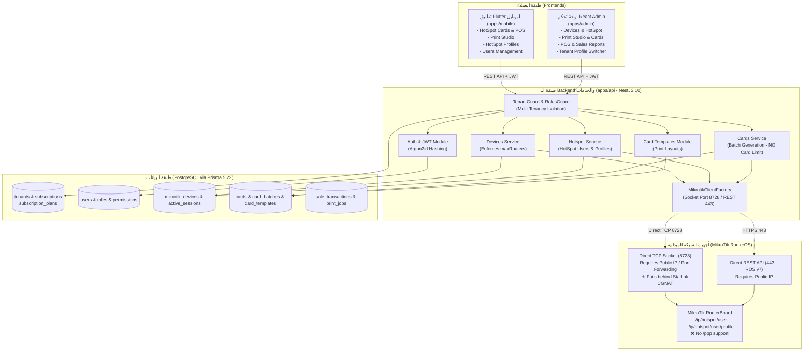

# تقرير التحليل المعماري والوظيفي الشامل وتحليل الفجوات (Gap Analysis)
## مشروع منصة إدارة شبكات MikroTik السحابية (SaaS)

- **تاريخ التحليل:** 10 أكتوبر 2026
- **المستودع:** `E:\microTik_project`
- **حالة التحليل:** مرحلة التدقيق المعماري والتحليل الوظيفي (لا توجد تعديلات برمجية أو ترحيلات لقاعدة البيانات في هذه المرحلة)
- **المكونات المفحوصة:**
  - تطبيق الهاتف: `apps/mobile` (Flutter 3.29 / Dart / Riverpod / Hive)
  - الخادم والـ API: `apps/api` (NestJS 10 / TypeScript / Prisma 5.22 / RouterOS Socket & REST)
  - لوحة التحكم: `apps/admin` (React 18 / Vite 5.4 / TypeScript / CSS)
  - قاعدة البيانات: `apps/api/prisma/schema.prisma` (PostgreSQL)
  - الحزم المشتركة: `packages/shared-types` و `packages/shared-validation`

---

## 1. الملخص التنفيذي (Executive Summary)

تم إجراء فحص عميق لكافة ملفات الكود، ومخطط قاعدة البيانات (Prisma Schema)، وعقود الـ API، ومنطق المصادقة وعزل المستأجرين، وبروتوكولات الاتصال بأجهزة MikroTik.

### جوهر النتيجة المعمارية:
المشروع الحالي يمتلك بنية تحتية قوية جداً كنظام إدارة شبكة فردية أو متجر كروت HotSpot محلي (Single Tenant / Branch POS)، مع وجود نواة أولية لتعدد المستأجرين (Multi-Tenancy Core) في الـ Backend. **ومع ذلك، هناك فجوة معمارية ووظيفية كبيرة بين الوضع الحالي وبين "منصة SaaS سحابية تجارية متكاملة" تخدم أصحاب شبكات متعددين وشبكات Starlink**:

1. **الاشتراكات والحصص (Quotas & Limits):**
   - حد الراوترات (`maxRouters`) موجود في المخطط ويُفرض برمجياً عند إضافة راوتر جديد.
   - حد الكروت الشهرية (`cardLimit` / `maxCards`) **غير موجود في قاعدة البيانات إطلاقاً**، ولا يُفحص عند توليد الكروت في `cards.service.ts`؛ بل توجد أرقام وهمية ثابتة (Hardcoded) في استجابة الـ API (`100,000` و `5,000`).
2. **شبكات Starlink والاتصال بالراوترات (Connectivity & CGNAT):**
   - آلية الاتصال الحالية تعتمد حصراً على فتح اتصال Socket مباشر (`net.connect` على المنفذ 8728) أو استدعاء REST API مباشر.
   - راوترات Starlink ومعظم خطوط الإنترنت المنزلية/الخلوية (4G/LTE) تقع خلف **CGNAT (Carrier-Grade NAT)** ولا تمتلك عناوين IP عامة ثابتة أو قابلة للوصول من السحابة. **الاتصال المباشر الحالي سيفشل 100% مع شبكات Starlink** ما لم يتم بناء نفق عكسي (Reverse VPN / WireGuard / SSTP) يربط الراوتر بالمنصة السحابية.
3. **دعم بروتوكول PPPoE / Broadband:**
   - بروتوكول PPPoE **غير مدعوم نهائياً** في أي جزء من أجزاء المنظومة (0% في قاعدة البيانات، و0% في واجهات الـ RouterOS Client، و0% في واجهات Flutter و React). المنظومة الحالية تدعم HotSpot فقط.
4. **لوحة مدير المنصة (Super Admin):**
   - الـ Backend يمتلك صلاحية `RoleName.SUPER_ADMIN` ومسارات محدودة للمستأجرين (`/api/v1/tenants`)، ولكن **لا توجد واجهة مستخدم (UI) خاصة بـ Super Admin في لوحة التحكم أو التطبيق** لإدارة الباقات والأسعار وتفعيل الاشتراكات يدوياً.
5. **تطبيق صاحب الشبكة (Customer App):**
   - يدعم إدارة الكروت، وتوليد البطاقات، ونقطة البيع، وتصميم قوالب الطباعة، وبروفايلات الهوتسبوت، وتغيير كلمة المرور.
   - يفتقر إلى: شاشة تسجيل حساب جديد (Sign Up)، شاشة استعراض الباقة والحصص المستهلكة/المتبقية، إدارة وإضافة راوترات جديدة، وتصميم صفحات الدخول (Captive Portal).

---

## 2. خريطة معمارية المشروع الحالي (Current Architectural Map)

---

## 3. مصفوفة مقارنة الميزات: الوضع الحالي مقابل رؤية العميل

| الميزة المطلوبة في رؤية العميل | الحالة في المشروع الحالي | الملفات والخدمات المسؤولة فعلياً | الفجوة المعمارية والبرمجية |
| :--- | :---: | :--- | :--- |
| **أولاً: تطبيق صاحب الشبكة (Customer App)** | | | |
| 1. تسجيل حساب صاحب شبكة جديد | **جزئية (API فقط)** | Backend: `auth.controller.ts` (`/auth/register`), `auth.service.ts` Mobile: غير موجود | مسار الـ API موجود، لكن شاشة التسجيل مفقودة تماماً في Flutter و React. |
| 2. تسجيل الدخول وإدارة الملف الشخصي | **مكتملة** | Mobile: `login_screen.dart`, `user_profile_screen.dart` Backend: `auth.controller.ts`, `auth.service.ts` | تعمل بالكامل مع دعم تغيير كلمة المرور عبر Argon2id. |
| 3. عرض تفاصيل الاشتراك والحصص المتبقية | **غير موجودة** | Backend: بيانات ثابتة في `tenants.service.ts` Mobile: غير معروضة في UI | لا توجد شاشة في Flutter تعرض عدد الكروت المتبقية أو الراوترات المستهلكة من الباقة. |
| 4. ربط وإدارة أجهزة MikroTik حسب الباقة | **جزئية** | Backend: `devices.service.ts`, `devices.controller.ts` Admin: `DevicesView.tsx` Mobile: استعراض فقط (`routersProvider`) | تطبيق Flutter لا يحتوي على شاشة لإضافة أو تعديل إعدادات الراوتر، وتقتصر الإضافة على لوحة التحكم. |
| 5. دعم شبكات Starlink والـ CGNAT | **غير موجودة** | Backend: `routeros-api.client.ts`, `routeros-rest.client.ts` | الاتصال يتطلب IP عام مباشر. راوترات Starlink خلف CGNAT لا يمكن للمنصة الوصول إليها حالياً. |
| 6. إنشاء كروت HotSpot وإدارتها | **مكتملة** | Mobile: `card_studio_screen.dart`, `cards_screen.dart` Backend: `cards.service.ts` DB: `cards`, `card_batches` | تعمل بالكامل محلياً وسحابياً مع دعم التوليد والبيع دون اتصال (Offline). |
| 7. إدارة بروفايلات HotSpot والسرعات والأسعار | **مكتملة** | Mobile: `hotspot_profiles_screen.dart`, `create_hotspot_profile_screen.dart` Backend: `hotspot.service.ts` | تدعم السرعة والمدة والسعر والمزامنة وحالة `NEEDS_SYNC`. |
| 8. إدارة بروفايلات ومستخدمي PPPoE / Broadband | **غير موجودة إطلاقاً** | غير موجودة في أي ملف عبر المشروع بالكامل | قاعدة البيانات والخدمات والعميل لا يمتلكون أي دعم لـ `/ppp/profile` أو `/ppp/secret`. |
| 9. تصميم قوالب الكروت للطباعة | **مكتملة** | Mobile: `card_template_editor_screen.dart`, `card_templates_screen.dart` Backend: `card-templates.service.ts` | تدعم الأبعاد والألوان وحقول QR وتصدير/استيراد JSON وطباعة PDF. |
| 10. تصميم صفحات تسجيل الدخول (Captive Portal) | **غير موجودة** | غير موجودة | لا يوجد محرر لصفحات تسجيل الدخول أو رفع ملفات HTML للراوتر. |
| 11. إدارة المبيعات ونقطة البيع والتقارير | **مكتملة** | Mobile: `pos_screen.dart`, `shift_summary_screen.dart` Backend: `sales.service.ts`, `reports.service.ts` | دعم كامل لورديات الكاشير، الفواتير الحرارية، وطابور المبيعات غير المتزامنة. |
| **ثانياً: لوحة مدير المنصة (Super Admin)** | | | |
| 1. إدارة حسابات أصحاب الشبكات (المستأجرين) | **جزئية (API فقط)** | Backend: `tenants.controller.ts` (`GET /tenants`, `PATCH /tenants/:id/status`) Admin: مبدل مستأجرين فقط في `Navbar.tsx` | لا توجد شاشة مخصصة لمدير المنصة لعرض جدول المستأجرين، تعليقهم، أو تفاصيلهم. |
| 2. إنشاء وتعديل وإيقاف باقات الاشتراك (Plans CRUD) | **غير موجودة** | DB: جدول `subscription_plans` Backend: لا يوجد Controller للباقات Admin: غير موجودة | جدول الخطط موجود في Prisma لكن لا توجد مسارات API أو واجهات لإدارتها ديناميكياً. |
| 3. تحديد حد الكروت لكل باقة وفرضه | **غير موجودة** | DB: الحقل غير موجود في المخطط Backend: أرقام ثابتة في `tenants.service.ts` | لا يوجد عمود `maxCards` في جدول الباقات، والـ API لا يمنع تجاوز الحصة. |
| 4. تحديد عدد أجهزة MikroTik وفرضه | **مكتملة (Backend فقط)** | Backend: `devices.service.ts` (سطر 115-122) DB: حقل `maxRouters` | يتم التحقق من سقف الراوترات بنجاح ورمي استثناء `ROUTER_LIMIT_EXCEEDED`. |
| 5. تحديد الميزات المتاحة لكل باقة (Feature Flags) | **جزئية (مخطط فقط)** | DB: حقل `features Json?` في `SubscriptionPlan` Backend: لا يوجد فحص للـ Features في الـ Guards | الحقل موجود كـ JSON في قاعدة البيانات ولكن لا يوجد Guard يتحقق من تفعيل الميزة للمستأجر. |
| 6. تفعيل الاشتراكات وتجديدها وتعليقها يدويًا | **جزئية (Backend فقط)** | Backend: `POST /tenants/:id/subscription/approve` في `tenants.controller.ts` | منطق التفعيل اليدوي مبرمج في السيرفر، لكن لا توجد واجهة في لوحة التحكم لاستخدامه. |
| 7. عرض حالة الاشتراك والاستخدام وتاريخ العمليات | **جزئية** | Backend: `audit_logs.service.ts` Admin: `AuditLogsView.tsx` | السجلات تُحفظ في قاعدة البيانات ولكن لا توجد لوحة تحليلية لمدير المنصة. |

---

## 4. التحليل المعماري التخصصي للقضايا الحرجة

### 4.1. تحدي شبكات Starlink و CGNAT
- **المشكلة التقنية:** راوترات MikroTik المتصلة عبر Starlink لا تحصل على Public IPv4 قابل للتوجيه، بل تقع ضمن نطاق CGNAT (`100.64.0.0/10`). الخادم السحابي (سواء على Render أو AWS أو أي VPS) لا يمكنه فتح اتصال TCP باتجاه الراوتر على المنفذ `8728` مباشرة.
- **الحل المعماري المطلوب للمنصة:**
  1. إنشاء خادم أنفاق مركزي (VPN Gateway) يدعم بروتوكول **WireGuard** أو **SSTP** أو **ZeroTier** مدمج مع المنصة السحابية.
  2. توليد سكربت إعداد تلقائي (Provisioning Script) يقوم صاحب الشبكة بنسخه ولصقه لمرة واحدة في الـ Terminal الخاص بالراوتر.
  3. يقوم الراوتر بفتح اتصال خارجي (Outbound Connection) باتجاه الـ VPN Gateway، مما يمنحه IP داخلي ثابت داخل شبكة المنصة المشفرة، وبذلك يستطيع الـ Backend مخاطبة الراوتر بكل موثوقية وأمان وتجاوز الـ CGNAT نهائياً.

### 4.2. غياب فرض حصص الكروت (Card Generation Limits)
- فحص ملف `apps/api/src/modules/cards/services/cards.service.ts` (الأسطر 80-240) أثبت أن دالة `generateBatch`:
  - تتحقق من وجود المستأجر والراوتر والبروفايل.
  - **لا تفحص إطلاقاً** عدد الكروت المولدة خلال الشهر الحالي مقابل حصة الاشتراك.
  - يستطيع أي مستأجر توليد عدد غير محدود من الكروت دون أن يمنعه الخادم.
- فحص `schema.prisma` أثبت أن نموذج `SubscriptionPlan` ونموذج `Subscription` يفتقران إلى حقل `maxCardsPerMonth` أو ما شابهه.
- الحقول المعروضة في إعدادات المستأجر بـ React Admin هي قيم ثابتة وهمية (`100,000` كرت) مدرجة يدوياً في كود الخادم بملف `tenants.service.ts`.

### 4.3. حقيقة تنفيذ العمليات على الراوتر مقابل قاعدة البيانات
- **توليد الكروت:** تُنشأ الكروت وتُحفظ في قاعدة البيانات أولاً. في حال كان الراوتر متصلاً، يتم استدعاء `client.createHotspotUser` لكل كرت. إذا فشل الاتصال بالراوتر، تُوسم الكروت بحالة `syncStatus: FAILED`، **ولكن الدفعة نفسها تُعتبر ناجحة ومكتملة (`CardBatchStatus.COMPLETED`) في استجابة الـ API**.
- **البروفايلات:** عند فشل الاتصال بالراوتر، يُحفظ البروفايل في قاعدة البيانات وتُسجل حالة مزامنة معلقة، مما يتيح استمرار عمل التطبيق ولكن البطاقات لن تعمل على أرض الواقع إلا بعد مزامنة فعلية مع الراوتر.
- **النتيجة:** يجب الفصل بوضوح في واجهة المستخدم بين "الحفظ السحابي" و"الجاهزية للتشغيل على الراوتر"، وتوفير زر مزامنة يدوي لمعالجة الدفعات العالقة.

### 4.4. التدقيق الأمني وعزل المستأجرين (Tenant Isolation & Security)
- **نقاط القوة:**
  - يتم استخراج `tenantId` من توكن الـ JWT حصراً عبر `@TenantId()` و `TenantGuard`، ولا يمكن للمستخدم تزويره عبر الـ Body أو الـ Query.
  - جميع كلمات مرور الراوترات مشفرة في قاعدة البيانات بمعيار `AES-256-GCM` مع IV ومفتاح توثيق فريد.
  - كلمات مرور المستخدمين مجزأة باستخدام خوارزمية **Argon2id** المتقدمة.
- **الثغرات والمخاطر المكتشفة الواجب معالجتها:**
  1. **الوقوع في فخ المستأجر الأول (Fallback Vulnerability):** في ملف `tenants.service.ts` (السطر 205) وملف `cards.service.ts` (السطر 83)، في حال كان `tenantId` غير محدد، يقوم الكود باسترجاع "أول مستأجر في قاعدة البيانات" كبديل (`firstTenant = findFirst`)! هذا السلوك يمثل خطراً كبيراً لتسرب البيانات إذا تم استدعاء المسار من سياق غير مكتمل.
  2. **غياب فحص الحصص (Quota Denial-of-Service):** عدم وجود سقف للكروت يسمح للمستأجر بإغراق قاعدة البيانات بملايين السجلات دون تكلفة.
  3. **الاتصال بالراوتر بدون تشفير:** إذا تم إدخال عنوان IP عام بدون تفعيل خيار SSL/TLS على المنفذ `8729`، تُنقل بيانات المستخدمين وجلسات Winbox/API بشكل غير مشفر عبر الإنترنت العام.

---

## 5. المتطلبات التي تحتاج إلى توضيح من العميل (Clarification Questions)

قبل الانتقال لمرحلة التنفيذ البرمجي، يجب حسم القرارات المعمارية التالية مع العميل:

1. **طريقة اتصال راوترات Starlink والشبكات المحلية بالمنصة:**
   - هل يفضل العميل اعتماد نفق VPN عكسي مبني على **WireGuard** (الأسرع والأخف على موارد الراوتر)، أم **SSTP/OVPN**، أم توفير وكيل محلي خفيف (Lightweight Local Agent)؟
2. **سياسة تجديد وانتهاء حصة الكروت:**
   - هل تُحسب حصة الكروت بناءً على "عدد الكروت المولدة شهرياً" أم "عدد الكروت النشطة في نفس الوقت"؟
   - عند الوصول إلى الحد الأقصى للحصة (مثلاً 5,000 كرت)، هل يتم منع التوليد تماماً حتى التجديد القادم، أم يُسمح بشراء حزم كروت إضافية (Add-on packs)؟
3. **تفاصيل متطلبات بروتوكول PPPoE:**
   - هل المطلوب في PPPoE هو إدارة اشتراكات منزلية ثابتة (اسم مستخدم، كلمة مرور، سرعة، مدة انتهاء، وسحب IP ثابت/ديناميكي)، أم نظام فوترة شهرية بفواتير دورية، أم كروت شحن مسبقة الدفع لـ PPPoE أيضاً؟
4. **آلية استيعاب وإدارة الاشتراكات في غياب الدفع الإلكتروني:**
   - بما أن الدفع الإلكتروني غير مطلوب حالياً، هل المطلوب هو نظام تفعيل يدوي من لوحة Super Admin (بعد استلام إشعار تحويل بنكي/نقدي خارج المنصة)، مع تحديد تاريخ بدء وانتهاء ورقم مرجعي؟
5. **هوية لوحة Super Admin:**
   - هل يفضل العميل أن تكون لوحة Super Admin شاشات مدمجة داخل لوحة الويب الحالية تظهر فقط عند تسجيل الدخول بحساب `SUPER_ADMIN`، أم تطبيقاً مستقلاً تماماً برابط وبورت منفصلين؟

---

## 6. خطة التنفيذ المقترحة مقسمة إلى مراحل مرتبة حسب الأولوية

### المرحلة الأولى: النواة المعمارية لإدارة الاشتراكات والحصص (SaaS Core & Quotas)
*الأولوية: قصوى (أساس تحويل المشروع إلى SaaS)*
1. **تحديث مخطط قاعدة البيانات (Prisma Schema):**
   - تعديل جدول `SubscriptionPlan` لإضافة: `maxCardsPerMonth Int`, `features Json`, `isPublic Boolean`.
   - تعديل جدول `Subscription` لربط الحصص الفعلية وتاريخ التجديد وعداد الاستهلاك الدوري.
   - إنشاء جدول `TenantUsageMetrics` لتتبع عدد الكروت المولدة وعدد الراوترات المضافة في الدورة الحالية.
2. **فرض سقف الكروت في الـ Backend:**
   - إضافة Guard أو فحص صارم في `cards.service.ts` لمنع إنشاء أي دفعة تتجاوز الحصة الشهرية المتبقية.
3. **سد ثغرات الـ Fallback:**
   - إزالة أي استعلام يبحث عن "أول مستأجر" كبديل افتراضي عند غياب المعرف لمنع أي تسرب بيانات بين المشتركين.

### المرحلة الثانية: لوحة مدير المنصة (Super Admin Control Panel)
*الأولوية: عالية (تمكين مالك المنصة من التحكم التجاري)*
1. **واجهات إدارة الباقات (Plans Management):**
   - بناء شاشات CRUD كاملة للباقات (الاسم، السعر، عدد الراوترات، سقف الكروت، والميزات).
2. **واجهات إدارة أصحاب الشبكات (Tenant Management):**
   - استعراض جميع أصحاب الشبكات، حالة الحسابات، تفاصيل الراوترات، وسجل استهلاك الكروت.
   - أزرار التحكم: تفعيل، تعليق (Suspend)، تعديل الباقة يدوياً، وتمديد فترة الترخيص.
3. **نظام التفعيل اليدوي للاشتراكات:**
   - واجهة لتسجيل الدفعات اليدوية، تعيين تاريخ الانتهاء، وإرفاق الملاحظات والإيصالات.

### المرحلة الثالثة: حل معضلة Starlink والاتصال العكسي (Starlink & Remote Provisioning)
*الأولوية: عالية (متطلب تشغيلي أساسي لبيئة Starlink)*
1. **تصميم خدمة الأنفاق العكسية (VPN Tunnel Provisioner):**
   - بناء وحدة في الـ Backend لتوليد إعدادات WireGuard أو SSTP خاصة بكل راوتر.
2. **سكربت الربط التلقائي (One-Click MikroTik Script):**
   - زر في واجهة المستخدم يولد كود RouterOS جاهز للنسخ، يحتوي على مفاتيح التشفير وعنوان خادم المنصة.
3. **تحديث عميل الاتصال (MikrotikClientFactory):**
   - توجيه الاتصالات عبر عنوان النفق الداخلي بدلاً من الـ IP الخارجي المباشر.

### المرحلة الرابعة: تطوير تطبيق صاحب الشبكة (Customer App Expansion)
*الأولوية: متوسطة*
1. **تسجيل الحساب الذاتي (Self Sign-Up):**
   - بناء شاشة "إنشاء حساب جديد" في تطبيق Flutter ولوحة التحكم مع اختيار الخطة وتفعيل الفترة التجريبية.
2. **عدادات استهلاك الباقة (Usage Dashboard):**
   - شاشة في Flutter تعرض بوضوح: الكروت المستخدمة / المتبقية، الراوترات المسجلة / المسموح بها، وتاريخ التجديد.
3. **إدارة الراوترات من التطبيق:**
   - إضافة شاشة في Flutter لإضافة راوتر جديد، فحص الاتصال، وتوليد سكربت الربط.

### المرحلة الخامسة: دعم بروتوكول PPPoE / Broadband
*الأولوية: لاحقة (بناءً على أولويات إطلاق المنتج)*
1. **تحديث قاعدة البيانات:**
   - إنشاء نماذج `PppoeProfile`, `PppSecret`, `PppActiveConnection`.
2. **توسيع عميل RouterOS:**
   - إضافة دوال `/ppp/profile` و `/ppp/secret` في `RouterOsApiClient` و `RouterOsRestClient`.
3. **بناء شاشات PPPoE:**
   - واجهات متخصصة في لوحة الويب وتطبيق الهاتف لإدارة خطوط البرودباند والسرعات والاشتراكات.

---

## 7. معايير واختبارات القبول لكل مرحلة (Acceptance Criteria)

- **المرحلة الأولى:**
  - محاولة توليد كروت تتجاوز الحصة الشهرية للمستأجر تُرفض برمز `403 Forbidden (QUOTA_EXCEEDED)` مع رسالة توضح الرصيد المتبقي.
  - إضافة راوتر بعد بلوغ سقف `maxRouters` تُرفض برمز `403 Forbidden`.
  - لا يمكن لأي مستأجر تحت أي ظرف قراءة أو استعراض بيانات مستأجر آخر.
- **المرحلة الثانية:**
  - يستطيع Super Admin إنشاء باقة جديدة وتحديد أسعارها وحصصها، وتنعكس فوراً على خيارات التسجيل.
  - يستطيع Super Admin تعليق مستأجر يدويًا، ويتم منعه فوراً من استخدام التطبيق أو توليد الكروت.
- **المرحلة الثالثة:**
  - راوتر MikroTik متصل عبر Starlink بدون IP عام يستطيع الاتصال بالمنصة السحابية بنجاح عبر النفق المولد واستقبال أوامر التوليد والبروفايلات.
- **المرحلة الرابعة:**
  - يتمكن صاحب شبكة جديد من تنزيل تطبيق Flutter وإنشاء حسابه، والدخول مباشرة لبدء فترته التجريبية.
- **المرحلة الخامسة:**
  - إضافة بروفايل PPPoE ومستخدم PPPoE من التطبيق تظهر فوراً في قائمة `/ppp secret` على راوتر MikroTik، ويستطيع العميل المنزلي الاتصال عبر المودم بنجاح.
