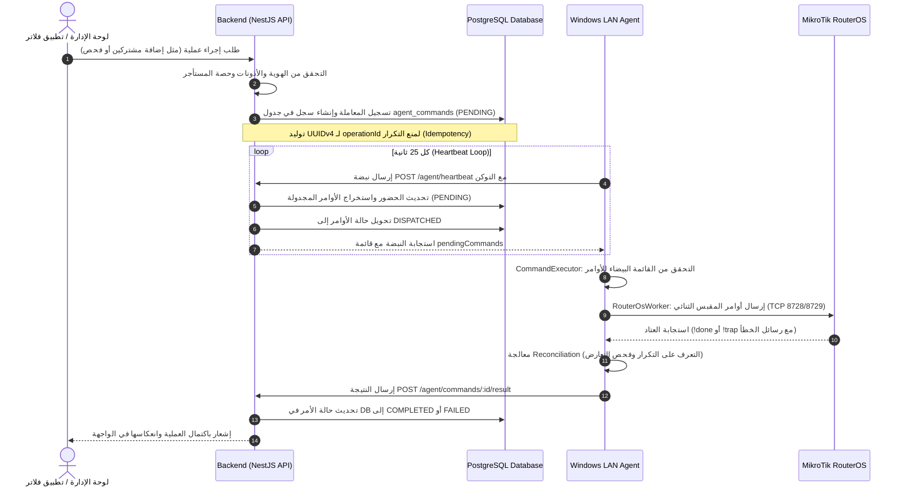
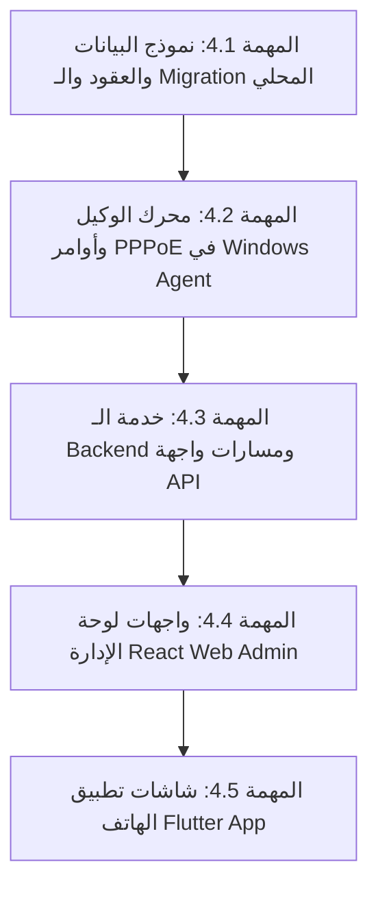

# تقرير فحص الوضع الحالي وخطة تنفيذ دعم PPPoE — Phase 4: PPPoE Assessment & Implementation Plan
## SudaFi Cloud Platform — Broadband / PPPoE Integration Architecture

**تاريخ التقرير:** 11 أكتوبر 2026  
**المسار الأساسي:** `E:\microTik_project`  
**الحالة:** تقرير فحص شامل وخطة تنفيذ دقيقة — **بانتظار المراجعة والاعتماد قبل أي تعديل على الكود**  
**المرحلة:** المرحلة الرابعة (Phase 4: PPPoE Support & Related Expansions)

---

## 1. الملخص التنفيذي (Executive Summary)

تم إعداد هذا التقرير استجابة لطلب فحص الجاهزية المعمارية وتخطيط الدعم لبروتوكول **PPPoE (Broadband Subscribers)** ضمن منظومة SudaFi MikroTik SaaS.  
أكد الفحص الفعلي للكود وقاعدة البيانات وواجهات Flutter ولوحة الإدارة والـ Agent أن:
1. **نسبة إنجاز كود PPPoE حالياً هي 0%:** لا توجد أي نماذج أو مسارات أو دوال برمجية مخصصة لـ PPPoE في أي طبقة من طبقات المنظومة الحالية، وجميع المراجع السابقة كانت توثيقية وتخطيطية فقط.
2. **البنية المعمارية الحالية (Architecture) مهيأة 100% للتوسعة دون أي كسر للنظام القائم:**
   - قناة اتصال الوكيل [`DeviceAgent`](file:///e:/microTik_project/apps/api/src/modules/agent/agent.service.ts) وطابور الأوامر [`AgentCommand`](file:///e:/microTik_project/apps/api/src/modules/agent/dto/command.dto.ts) تعتمد على نمط الرسائل المعزولة (`Message Dispatcher Pattern`)، مما يسمح بإضافة معالجات أوامر PPPoE دون المساس بمعالجات HotSpot.
   - أوامر MikroTik لنظام PPPoE (`/ppp/profile` و `/ppp/secret` و `/ppp/active`) معزولة تماماً في نواة RouterOS عن مسارات الهوتسبوت (`/ip/hotspot/*`).
   - جداول البطاقات [`cards`](file:///e:/microTik_project/apps/api/prisma/schema.prisma) ونظام الحصص والاشتراكات [`QuotasService`](file:///e:/microTik_project/apps/api/src/modules/cards/services/quotas.service.ts) مستقلة ومفصولة ولن تتأثر بإضافة مشتركي النطاق العريض.

---

## 2. نتائج فحص الوضع الحالي (Current State Technical Audit)

### 2.1 هل توجد أي وظائف PPPoE حالياً؟ وما المكتمل منها؟
* **النتيجة القطعية:** **لا توجد أي وظيفة PPPoE مكتملة أو قيد التنفيذ في الكود الفعلي (0% إنجاز).**
* **سجل التحقق من المستودع:**
  - في `apps/api/prisma/schema.prisma`: لا توجد جداول أو حقول لـ `pppoe` أو `ppp`.
  - في `apps/api/src/`: لا يوجد موديول `pppoe` أو أي مسار API لمعالجة حسابات النطاق العريض.
  - في `apps/agent/src/`: يقتصر `AgentCommandType` حصراً على أوامر الصحة و 4 أوامر هوتسبوت (`system.router.health`, `hotspot.user.batch_add`, `hotspot.user.remove`, `hotspot.user.verify_batch`, `hotspot.session.list`).
  - في `apps/admin/src/`: تقتصر إدارة المستخدمين والشبكات على `hotspot` و `cards` و `devices`.
  - في `apps/mobile/lib/features/`: لا توجد شاشات أو خدمات لـ PPPoE.
  - في `packages/shared-types`: لا توجد Enums أو Interfaces خاصة بـ PPPoE.
  - **الإشارات الوحيدة** لـ PPPoE وردت في وثائق سابقة (`docs/client-vision-gap-analysis.md` و `docs/phase3-connectivity-architecture-report.md`) كأهداف مؤجلة للمرحلة الرابعة.

---

### 2.2 كيف تُدار HotSpot Users و Profiles حالياً؟
1. **البروفايلات (HotSpot Profiles):**
   - تُخزن في جدول [`hotspot_profiles`](file:///e:/microTik_project/apps/api/prisma/schema.prisma#L353-L376) المرتبط بالراوتر والمستأجر.
   - تدار في الـ Backend عبر مسار [`/api/v1/hotspot/profiles`](file:///e:/microTik_project/apps/api/src/modules/hotspot/hotspot.controller.ts) مع دوال إنشاء وتعديل وحذف.
   - في الراوتر: تُنشأ تحت المسار `/ip/hotspot/user/profile` وتحدد السرعة `rate-limit` ومهلة الجلسة `session-timeout` والمستخدمين المشتركين `shared-users`.
   - في واجهة الويب: تُعرض وتدار عبر شاشة [`HotspotProfilesView.tsx`](file:///e:/microTik_project/apps/admin/src/modules/hotspot/HotspotProfilesView.tsx).
   - في واجهة فلاتر: تدار عبر `features/hotspot_profiles`.
2. **المستخدمون والبطاقات (HotSpot Users / Prepaid Cards):**
   - لا يُنشأ مستخدمو الهوتسبوت فرادى في الاستخدام العادي، بل ضمن **دفعات بطاقات (Card Batches)** عبر جدولين:
     * [`card_batches`](file:///e:/microTik_project/apps/api/prisma/schema.prisma#L430): يمثل الدفعة، البروفايل، السعر، عدد البطاقات، والصلاحية.
     * [`cards`](file:///e:/microTik_project/apps/api/prisma/schema.prisma#L465): يمثل كل بطاقة باسم مستخدم فريد، وكلمة مرور مشفرة بـ AES-256-GCM، وحالة البطاقة (`AVAILABLE`, `SOLD`, `ACTIVE`, `EXPIRED`, `DISABLED`).
   - عند الإنشاء، يتحقق [`QuotasService`](file:///e:/microTik_project/apps/api/src/modules/cards/services/quotas.service.ts) من سريان اشتراك المستأجر وحصته الشهرية من البطاقات المسموحة (`cardGenerationLimit`).
   - تُرسل البطاقات للراوتر دفعة واحدة عبر أمر `hotspot.user.batch_add` وتُخزن في `/ip/hotspot/user`.
3. **الجلسات النشطة (Active Sessions):**
   - يستعلم الوكيل دورياً عن `/ip/hotspot/active/print` ويرفع بيانات المتصلين (IP, MAC, Uptime, Bytes).

---

### 2.3 كيف تمر الأوامر من التطبيق إلى Backend ثم Windows Agent ثم MikroTik؟
يمر تدفق الأوامر في النظام عبر المراحل المتسلسلة التالية:

---

### 2.4 ما الملفات والجداول والواجهات التي ستتأثر بإضافة PPPoE؟

| الطبقة / المكون | الجداول / الملفات المتأثرة | نوع التأثير المطلوب |
| :--- | :--- | :--- |
| **قاعدة البيانات (Prisma DDL)** | `apps/api/prisma/schema.prisma` `prisma/migrations/*` | - إنشاء جدول `pppoe_profiles` (لبروفايلات السرعة). - إنشاء جدول `pppoe_accounts` (لحسابات المشتركين المنزليين). - إنشاء جدول `pppoe_active_sessions` (للجلسات الحية). - إضافة Enums: `PppoeAccountStatus`. |
| **الأنواع المشتركة (Shared Types)** | `packages/shared-types/src/index.ts` | - توسيع `AgentCommandType` لإضافة أوامر PPPoE الثمانية. - إضافة DTOs و Enums المشتركة لـ PPPoE. |
| **خادم الـ Backend (NestJS API)** | `apps/api/src/modules/pppoe/*` (جديد) `apps/api/src/app.module.ts` `apps/api/src/modules/agent/dto/command.dto.ts` `apps/api/src/core/mikrotik/interfaces/mikrotik-client.interface.ts` | - إنشاء موديول `PppoeModule` (Controller, Service, DTOs). - تسجيل الموديول في `app.module.ts`. - توسيع القائمة البيضاء للأوامر في `command.dto.ts`. - إضافة دوال PPP في واجهة العميل المباشر. |
| **وكيل الويندوز (Windows Agent)** | `apps/agent/src/types/index.ts` `apps/agent/src/router/interfaces/router-worker.interface.ts` `apps/agent/src/router/routeros-worker.ts` `apps/agent/src/router/mock-router-worker.ts` `apps/agent/src/executor/command-executor.ts` | - إضافة أنواع بيانات PPPoE للوكيل. - تطبيق أوامر `/ppp/profile` و `/ppp/secret` و `/ppp/active` في `RouterOsWorker`. - تحديث `MockRouterWorker` للاختبار المعزول. - توسيع `CommandExecutor` لتنفيذ أوامر PPPoE. |
| **لوحة الإدارة (Admin Web React)** | `apps/admin/src/modules/pppoe/*` (جديد) `apps/admin/src/components/layout/Sidebar.tsx` `apps/admin/src/App.tsx` `apps/admin/src/core/types/view-models.ts` | - إنشاء شاشات `PppoeAccountsView` و `PppoeProfilesView` و `PppoeActiveSessionsView`. - إضافة عناصر PPPoE للشريط الجانبي والموجه. |
| **تطبيق الهاتف (Flutter App)** | `apps/mobile/lib/features/pppoe/*` (جديد) `apps/mobile/lib/core/constants/api_endpoints.dart` `apps/mobile/lib/core/models/models.dart` | - إنشاء شاشات إدارة المشتركين المنزليين في تطبيق فلاتر. - إضافة نقاط النهاية ونماذج البيانات. |

---

### 2.5 هل تصميم النظام الحالي يدعم التوسعة دون كسر وظائف HotSpot والاشتراكات وحدود البطاقات؟
> [!IMPORTANT]
> **نعم بنسبة 100%، والتصميم يدعم إضافة PPPoE بأمان تام دون أي تعارض مع HotSpot.**

* **الأدلة الفنية القاطعة من الكود:**
  1. **العزل التام للأوامر في قناة الوكيل:** يعتمد جدول `agent_commands` وموجه الأوامر `CommandExecutor` على حقل نصي `type` لكل أمر (`system.router.health`, `hotspot.user.batch_add`, إلخ). إضافة أوامر جديدة تبدأ بـ `pppoe.*` لن يؤثر على أي معالج هوتسبوت قائم.
  2. **عزل أوامر RouterOS:** في MikroTik، مسارات الهوتسبوت هي `/ip/hotspot/*`، ومسارات البرودباند هي `/ppp/*`. لا توجد أي نقاط تقاطع أو تضارب في الأسماء أو الجداول داخل نظام التشغيل.
  3. **عزل حدود الاشتراكات:** يعتمد كود [`QuotasService`](file:///e:/microTik_project/apps/api/src/modules/cards/services/quotas.service.ts) على فحص جدول `cards` المخصص لبطاقات الهوتسبوت مسبقة الدفع. المشتركون المنزليون (PPPoE) يمتلكون اشتراكات ثابتة ومستمرة لا تستهلك من حصص بطاقات الكاشير مسبقة الدفع، مما يضمن استمرار عمل نظام الكروت دون أدنى تأثير.

---

## 3. تحديد المتطلبات التفصيلية قبل البرمجة (PPPoE Requirements Specification)

### 3.1 المتطلبات المؤكدة (Confirmed Core Requirements)

#### 1. إدارة بروفايلات السرعة (PPP Profiles)
- إنشاء وقراءة وتعديل بروفايلات `/ppp/profile` في الراوتر المعملي وقاعدة البيانات.
- الخصائص الإلزامية:
  * `name`: اسم البروفايل (مثل `Profile-4Mbps`, `Home-Fiber-10M`).
  * `rateLimit`: حد السرعة (مثل `4M/8M` - رفع/تنزيل).
  * `localAddress`: عنوان بوابة الراوتر للعميل (أو اسم pool).
  * `remoteAddress`: اسم مجمع عناوين الـ IP المخصص لـ PPPoE (IP Pool).
  * `dnsServer`: خوادم DNS الموزعة على المشترك (مثل `8.8.8.8,1.1.1.1`).
  * `onlyOne`: قصر تسجيل الدخول على جلسة واحدة نشطة لكل مشترك (`only-one=yes`).

#### 2. إدارة حسابات المشتركين (PPP Secrets)
- إنشاء وتعديل وحذف حسابات المشتركين في `/ppp/secret`.
- الخصائص الإلزامية:
  * `username`: اسم مستخدم فريد على مستوى الراوتر والمستأجر.
  * `password`: كلمة مرور المشترك (مشفرة في قاعدة البيانات بـ AES-256-GCM مثل البطاقات).
  * `service`: بروتوكول الخدمة (محدد حصراً بـ `pppoe`).
  * `profile`: اسم البروفايل المرتبط بالحساب.
  * `callerId`: قفل الماك أدرس اختياري للمودم المنزلي (MAC binding) لمنع مشاركة الحساب.
  * `remoteAddress`: تخصيص عنوان IP ثابت للمشترك المنزلي (Static IP) عند الطلب.
  * `comment`: تخزين معرّف الحساب وملاحظات المشترك في الراوتر للتعرف السريع.
  * `disabled`: حالة الحساب (`yes` للتعطيل و `no` للتفعيل).

#### 3. دورة حياة الحساب وإجراءات التحكم الميداني
- **تعطيل الحساب (Disable Account):** عند انتهاء الاشتراك أو التعليق، يتم وضع `disabled=yes` في الراوتر، وفصل الجلسة النشطة فوراً من جدول `/ppp/active` لقطع خدمة الإنترنت في نفس اللحظة.
- **إعادة التفعيل (Enable Account):** إعادة تفعيل الحساب بوضع `disabled=no` لتمكين المودم من إعادة الاتصال التلقائي.
- **حذف الحساب (Delete Account):** إزالة الحساب نهائياً من `/ppp/secret` بعد فصل جلسته الحالية.

#### 4. منع التكرار وإدارة التعارض الآمنة (Idempotency & Conflict Protection)
- إذا حاول النظام إعادة إرسال أمر إضافة حساب موجود مسبقاً بنفس المواصفات (حالة فقدان إشعار Lost Ack): يتعرف الوكيل عليه ويحتسبه كـ `alreadyExistingCount = 1` دون خطأ ودون إعادة إنشاء.
- إذا وجد الوكيل حساباً موجوداً مسبقاً باسم متطابق ولكن ببروفايل أو كلمة مرور مختلفة: يُرفض الإجراء فوراً كـ `Conflict` لمنع إتلاف بيانات مشترك منزلي قائم على الراوتر.

#### 5. مراقبة الجلسات الحية وفصل الاتصال (Active Sessions & Disconnect)
- استعلام دوري عن جدول `/ppp/active` لجلب:
  * اسم المشترك المتصل (`name`).
  * عنوان الـ IP المخصص حالياً للمودم (`address`).
  * عنوان الماك أدرس (`caller-id`).
  * مدة الجلسة الحالية المستمرة (`uptime`).
- توفير أمر طرد/فصل الجلسة فورياً: `/ppp/active/remove` لإجبار المودم على إعادة التفاوض عند تغيير السرعة أو تعليق الحساب.

---

### 3.2 الميزات المقترحة التي تحتاج إلى قرار مستقبلي (Proposed / Decisions Pending)

| الميزة المقترحة | الوصف التقني | الوضع الموصى به للمرحلة الرابعة |
| :--- | :--- | :--- |
| **1. الفوترة الدورية الآلية والتجديد الشهري** | إصدار فواتير شهرية آلية دورية، وتعليق الحساب تلقائياً عند حلول موعد الاستحقاق ما لم يسدد العميل. | **مرحلة لاحقة:** البدء بنظام تاريخ انتهاء يدوي/محدد، ثم ربطه بمحرك الفوترة بعد استقرار الاتصال. |
| **2. قفل الحصة السحابية لمشتركي PPPoE** | وضع حد أقصى لعدد مشتركي PPPoE المسموح بهم في باقات SaaS (مثلاً 50 مشترك في باقة Basic، 200 في Pro). | **قرار منتج:** يحدد المالك هل يريد فرض حد على عدد المشتركين أم ربطه بعدد الراوترات فقط. |
| **3. تحديد حجم استهلاك البيانات (FUP Data Quota)** | تحديد باقات بسعة جيجابايت (مثلاً 100 جيجابايت شهرياً لـ PPPoE). | **تأجيل للمرحلة القادمة:** لأن RouterOS لا يدعم قطع الـ PPP عند استهلاك الحجم ذاتياً دون خادم Radius خارجي أو سكربتات ثقيلة تؤثر على المعالج. دعم السرعة (Rate Limit) كافٍ تماماً ومدمج بنسبة 100%. |

---

## 4. خطة التنفيذ التفصيلية (Step-by-Step Implementation Roadmap)

تم تقسيم العمل إلى **5 مهام هندسية صغيرة مرتبة بدقة**، تضمن استمرار العمل دون كسر أي ميزة قائمة:

---

### المهمة 4.1: نموذج البيانات والعقود البرمجية (Data Models & Contracts)
* **الوظائف المطلوبة:**
  - إضافة نماذج `PppoeProfile` و `PppoeAccount` و `PppoeActiveSession` في `schema.prisma`.
  - إضافة Enum: `PppoeAccountStatus` (`ACTIVE`, `DISABLED`, `EXPIRED`, `SUSPENDED`).
  - توسيع `AgentCommandType` في `packages/shared-types` بالأوامر:
    * `pppoe.profile.sync`
    * `pppoe.secret.add`
    * `pppoe.secret.update`
    * `pppoe.secret.disable`
    * `pppoe.secret.enable`
    * `pppoe.secret.remove`
    * `pppoe.session.list`
    * `pppoe.session.disconnect`
* **الملفات والجداول المتأثرة:**
  - `apps/api/prisma/schema.prisma`
  - `packages/shared-types/src/index.ts`
  - إنشاء ملف migration محلي جديد: `20261011190000_add_pppoe_support`.
* **الاختبارات:**
  - تطبيق الـ Migration على قاعدة الاختبار المحلية المعزولة `sudafi_test` دون لمس الإنتاج.
  - فحص تكامل العلاقات والمفاتيح الخارجية والفهارس.

---

### المهمة 4.2: محرك الوكيل والمحاكي المعزول (Windows Agent PPPoE Engine)
* **الوظائف المطلوبة:**
  - توسيع واجهة [`IRouterWorker`](file:///e:/microTik_project/apps/agent/src/router/interfaces/router-worker.interface.ts) بدوال PPPoE.
  - تنفيذ دوال RouterOS في [`RouterOsWorker`](file:///e:/microTik_project/apps/agent/src/router/routeros-worker.ts):
    * إدارة البروفايلات: `/ppp/profile/add`, `/ppp/profile/set`, `/ppp/profile/print`.
    * إدارة الحسابات: `/ppp/secret/add`, `/ppp/secret/set`, `/ppp/secret/remove`, `/ppp/secret/print`.
    * إدارة الجلسات: `/ppp/active/print`, `/ppp/active/remove`.
    * تطبيق منطق Reconciliation الذكي (التعرف على التكرار وحظر التعارض).
  - تحديث [`MockRouterWorker`](file:///e:/microTik_project/apps/agent/src/router/mock-router-worker.ts) بمحاكاة كاملة لـ PPP.
  - تحديث [`CommandExecutor`](file:///e:/microTik_project/apps/agent/src/executor/command-executor.ts) لربط الأوامر بالدوال المناسبة.
* **الاختبارات:**
  - كتابة اختبارات وحدة جديدة في `apps/agent` لتغطية كافة سيناريوهات PPPoE (إضافة، تكرار، تعارض، فصل).
  - التأكد من اجتياز 100% من اختبارات الوكيل.

---

### المهمة 4.3: خدمة الـ Backend ومسارات الـ API (NestJS PppoeModule)
* **الوظائف المطلوبة:**
  - إنشاء موديول [`PppoeModule`](file:///e:/microTik_project/apps/api/src/modules/pppoe/):
    * `PppoeService`: التحقق من المستأجر، تشفير كلمة المرور بـ AES-256-GCM، إنشاء الحساب، وجدولة أوامر الوكيل عبر `AgentService.queueCommand`.
    * `PppoeController`: مسارات CRUD كاملة محمية بالحراس (`JwtAuthGuard`, `TenantGuard`, `RolesGuard`).
    * DTOs مع التحقق الصارم (`class-validator` و `ApiProperty`).
* **تغييرات API المطلوبة:**
  - `GET /api/v1/pppoe/profiles`: قائمة البروفايلات.
  - `POST /api/v1/pppoe/profiles`: إنشاء بروفايل جديد.
  - `GET /api/v1/pppoe/accounts`: استعراض حسابات المشتركين مع الفلترة والبحث.
  - `POST /api/v1/pppoe/accounts`: إنشاء مشترك منزلي جديد وجدولة أمره للراوتر.
  - `PATCH /api/v1/pppoe/accounts/:id`: تعديل بيانات المشترك أو باقته.
  - `POST /api/v1/pppoe/accounts/:id/disable`: تعطيل المشترك وفصل جلسته النشطة.
  - `POST /api/v1/pppoe/accounts/:id/enable`: إعادة تفعيل المشترك.
  - `DELETE /api/v1/pppoe/accounts/:id`: حذف المشترك من النظام والراوتر.
  - `GET /api/v1/pppoe/sessions`: عرض الجلسات النشطة في الراوتر.
  - `POST /api/v1/pppoe/sessions/:id/disconnect`: فصل جلسة نشطة.
* **الاختبارات:**
  - اختبارات وحدة شاملة لـ `PppoeService` و `PppoeController`.
  - اختبار تكاملي محلي لدورة PPPoE الكاملة ضد قاعدة بيانات الاختبار وMockRouter.

---

### المهمة 4.4: واجهات لوحة الإدارة (Admin Web Dashboard)
* **الوظائف المطلوبة:**
  - بناء موديول `apps/admin/src/modules/pppoe/`:
    * [`PppoeAccountsView.tsx`](file:///e:/microTik_project/apps/admin/src/modules/pppoe/PppoeAccountsView.tsx): جدول المشتركين، أزرار التفعيل والتعطيل والحذف، بطاقات إحصائيات سريعة، نافذة إنشاء مشترك جديد.
    * [`PppoeProfilesView.tsx`](file:///e:/microTik_project/apps/admin/src/modules/pppoe/PppoeProfilesView.tsx): إدارة باقات السرعة وأسعارها.
    * [`PppoeActiveSessionsView.tsx`](file:///e:/microTik_project/apps/admin/src/modules/pppoe/PppoeActiveSessionsView.tsx): مراقبة المشتركين المتصلين لحظياً مع زر فصل الاتصال.
  - تحديث القائمة الجانبية [`Sidebar.tsx`](file:///e:/microTik_project/apps/admin/src/components/layout/Sidebar.tsx) لإضافة قسم "مشتركو النطاق العريض (PPPoE)".
  - تحديث موجه المسارات في [`App.tsx`](file:///e:/microTik_project/apps/admin/src/App.tsx).

---

### المهمة 4.5: واجهات تطبيق الهاتف (Flutter Mobile App)
* **الوظائف المطلوبة:**
  - بناء مجلد `apps/mobile/lib/features/pppoe/`:
    * شاشة المشتركين: عرض قائمة المشتركين مع شارات الحالة (نشط، معطل، منتهي).
    * نموذج إضافة/تعديل مشترك منزلي جديد.
    * شاشة الاتصالات الحية: استعراض المتصلين وفصل الجلسة.
  - تسجيل نقاط النهاية في `api_endpoints.dart`.

---

## 5. مصفوفة المخاطر وطريقة الحفاظ على التوافق التام (Risks & Mitigation Matrix)

| الخطر المحتمل | مستوى الخطر | خطة الحماية والوقاية المعتمدة |
| :--- | :---: | :--- |
| **تأثر نظام بطاقات الهوتسبوت الحالي** | معدوم (Low) | عزل الجداول تماماً (`cards` مستقلة عن `pppoe_accounts`)، وعزل معالجات أوامر الوكيل. |
| **تداخل الأسماء بين مستخدمي Hotspot و PPPoE** | منخفض (Low) | في RouterOS، جداول `/ip/hotspot/user` منفصلة تماماً عن `/ppp/secret`، ولا يحدث أي تداخل حتى لو تشابه اسم المستخدم. |
| **تلف حساب مشترك موجود مسبقاً على الراوتر** | متوسط (Medium) | تطبيق Reconciliation مشدد: فحص الحساب قبل الإضافة، وحظر التعديل فوراً إذا اختلف البروفايل أو كلمة المرور (`Conflict Protection`). |
| **تعليق اتصال المودم المنزلي عند التعطيل** | منخفض (Low) | عند إرسال أمر التعطيل `disable`، يتبعه الوكيل تلقائياً بأمر فصل الجلسة من `/ppp/active` لقطع الإنترنت فوراً دون انتظار إعادة تشغيل المودم. |
| **انقطاع اتصال الوكيل أثناء جدولة الأوامر** | منخفض (Low) | اعتماد آلية `AgentCommand` مع `operationId` الذرية والنبضات الدورية، وتخزين الأوامر في DB حتى يعود الوكيل للعمل. |

---

## 6. الخلاصة والتوصية المحددة (Recommendation & First Step)

### هل المشروع جاهز لبدء تنفيذ المرحلة الرابعة (PPPoE)؟
> [!IMPORTANT]
> **نعم، المشروع في أعلى درجات الجاهزية الفنية والمعمارية للبدء في تنفيذ دعم PPPoE.**  
> تم تأسيس كافة الطبقات الأساسية (قاعدة البيانات، نظام المصادقة، طابور الأوامر، ووكيل الويندوز المحلي) بنجاح واجتياز 201 اختبار تكاملي ووحدي محلي بنسبة 100%.

### ما أول مهمة محددة يجب تنفيذها؟
**المهمة الأولى المحددة للبدء فور اعتمادكم هي:**
> **[المهمة 4.1: نموذج البيانات والعقود والـ Migration المحلي (Schema & Shared Contracts)]**  
> وتتضمن:
> 1. إضافة جداول `pppoe_profiles` و `pppoe_accounts` و `pppoe_active_sessions` إلى `schema.prisma`.
> 2. إضافة أوامر `pppoe.*` في حزمة الأنواع المشتركة `packages/shared-types`.
> 3. إنشاء وتطبيق الـ Migration واختباره على قاعدة البيانات المحلية المعزولة `sudafi_test` دون المساس بقاعدة بيانات الإنتاج.

---

> [!NOTE]
> **التزام تام بالضوابط الإلزامية:** لم يتم إجراء أي تعديل برمجي على الكود أو قاعدة البيانات حتى الآن، ولم يتم النشر على Render أو الاتصال براوتر حقيقي، بانتظار مراجعتكم لهذا التقرير وخطة التنفيذ لإصدار أمر البدء.
