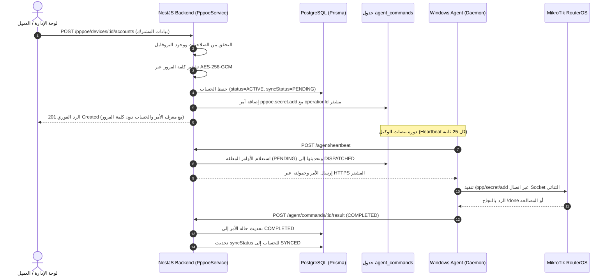

# تقرير إنجاز المهمة 4.3: بناء Backend API لدعم PPPoE وربطه بنظام الأوامر والوكيل

**المشروع:** SudaFi MikroTik Cloud SaaS Platform  
**المسار:** `E:\microTik_project`  
**المرحلة:** المرحلة الرابعة — توسع شبكات النطاق العريض والاشتراكات المنزلية (PPPoE & Broadband Support)  
**المهمة:** 4.3 — بناء Backend API لدعم PPPoE وربطه بنظام الأوامر وWindows Agent  
**التاريخ:** 12 أكتوبر 2026  
**الحالة:** مكتملة بنجاح بنسبة 100% (Completed)

---

## 1. ملخص تنفيذي للمهمة

تم في هذه المهمة إنشاء طبقة Backend API متكاملة وآمنة لإدارة اشتراكات وبروفايلات وجلسات PPPoE ضمن تطبيق الخادم (`apps/api`) عبر وحدة نمطية جديدة `PppoeModule`، تضم:
1. خدمة المعالجة البرمجية [`PppoeService`](file:///E:/microTik_project/apps/api/src/modules/pppoe/pppoe.service.ts).
2. وحدة التحكم وواجهات الـ REST API [`PppoeController`](file:///E:/microTik_project/apps/api/src/modules/pppoe/pppoe.controller.ts).
3. كائنات نقل البيانات الصارمة DTOs للتحقق والتنسيق.
4. الربط المباشر مع محرك أوامر الوكيل الحالي `AgentService` وقاعدة البيانات `PrismaService` وخدمة التشفير `EncryptionService`.

تم الالتزام التام بكافة الحدود الصارمة:
- لم يتم الاتصال بأي راوتر حقيقي أو راوتر عميل.
- لم يتم المساس بقاعدة بيانات الإنتاج أو Supabase أو خوادم Render.
- لم يُجرَ أي Migration إضافي (تم الاعتماد على النماذج الثلاثة المنشأة في المهمة 4.1).
- تم الحفاظ على العزل التام بين المستأجرين والأجهزة، وحماية كلمات المرور تشفيرياً (AES-256-GCM) مع حجبها من جميع استجابات الـ API.
- اختبارات Backend السابقة لوظائف HotSpot والبطاقات والاشتراكات لم تتأثر بنسبة 100% (Zero Regression).

---

## 2. الملفات التي أُنشئت أو عُدّلت

| الملف | النوع | الوصف |
|---|---|---|
| [`apps/api/src/modules/pppoe/dto/create-pppoe-profile.dto.ts`](file:///E:/microTik_project/apps/api/src/modules/pppoe/dto/create-pppoe-profile.dto.ts) | **جديد** | التحقق من بيانات إنشاء بروفايل PPPoE (`name`, `rateLimit`, `localAddress`, `remoteAddress`, `dnsServers`, `onlyOne`, `price`, `description`). |
| [`apps/api/src/modules/pppoe/dto/update-pppoe-profile.dto.ts`](file:///E:/microTik_project/apps/api/src/modules/pppoe/dto/update-pppoe-profile.dto.ts) | **جديد** | التحقق من بيانات تعديل بروفايل PPPoE. |
| [`apps/api/src/modules/pppoe/dto/pppoe-profile-response.dto.ts`](file:///E:/microTik_project/apps/api/src/modules/pppoe/dto/pppoe-profile-response.dto.ts) | **جديد** | صياغة استجابة البروفايل بما فيها عدد الحسابات المرتبطة ومعرف الأمر المجدول `queuedCommandId`. |
| [`apps/api/src/modules/pppoe/dto/create-pppoe-account.dto.ts`](file:///E:/microTik_project/apps/api/src/modules/pppoe/dto/create-pppoe-account.dto.ts) | **جديد** | التحقق من مدخلات حساب المشترك الجديد (الاسم، كلمة المرور، البروفايل، ماك الراوتر، العنوان الثابت، الهاتف، السعر، دورة الفوترة). |
| [`apps/api/src/modules/pppoe/dto/update-pppoe-account.dto.ts`](file:///E:/microTik_project/apps/api/src/modules/pppoe/dto/update-pppoe-account.dto.ts) | **جديد** | التحقق من مدخلات تعديل الحساب (كلمة المرور اختيارية ويعاد تشفيرها فوراً إذا أُرسلت). |
| [`apps/api/src/modules/pppoe/dto/pppoe-account-response.dto.ts`](file:///E:/microTik_project/apps/api/src/modules/pppoe/dto/pppoe-account-response.dto.ts) | **جديد** | استجابة الحساب الآمنة (محجوب منها تماماً كلمة المرور أو نصوص التشفير أو IV). |
| [`apps/api/src/modules/pppoe/dto/query-pppoe-accounts.dto.ts`](file:///E:/microTik_project/apps/api/src/modules/pppoe/dto/query-pppoe-accounts.dto.ts) | **جديد** | معاملات التصفية والبحث والترقيم للحسابات (`status`, `profileId`, `search`, `page`, `limit`). |
| [`apps/api/src/modules/pppoe/dto/pppoe-session-response.dto.ts`](file:///E:/microTik_project/apps/api/src/modules/pppoe/dto/pppoe-session-response.dto.ts) | **جديد** | استجابة الجلسات النشطة المستعلمة من الراوتر/قاعدة البيانات. |
| [`apps/api/src/modules/pppoe/dto/disconnect-pppoe-session.dto.ts`](file:///E:/microTik_project/apps/api/src/modules/pppoe/dto/disconnect-pppoe-session.dto.ts) | **جديد** | معاملات طلب فصل الجلسة بموجب اسم المستخدم أو معرّف الجلسة. |
| [`apps/api/src/modules/pppoe/dto/index.ts`](file:///E:/microTik_project/apps/api/src/modules/pppoe/dto/index.ts) | **جديد** | تجميع وتصدير كائنات DTOs. |
| [`apps/api/src/modules/pppoe/pppoe.service.ts`](file:///E:/microTik_project/apps/api/src/modules/pppoe/pppoe.service.ts) | **جديد** | منطق الأعمال الشامل (التحقق من الصلاحيات، عزل الأجهزة، التشفير، الجدولة للأوامر، حظر حذف البروفايلات المرتبطة). |
| [`apps/api/src/modules/pppoe/pppoe.controller.ts`](file:///E:/microTik_project/apps/api/src/modules/pppoe/pppoe.controller.ts) | **جديد** | نقاط النهاية REST API المحمية بحراس `JwtAuthGuard`, `TenantGuard`, `RolesGuard`. |
| [`apps/api/src/modules/pppoe/pppoe.module.ts`](file:///E:/microTik_project/apps/api/src/modules/pppoe/pppoe.module.ts) | **جديد** | وحدة NestJS المستقلة لـ PPPoE وتصدير خدماتها. |
| [`apps/api/src/modules/pppoe/pppoe.service.spec.ts`](file:///E:/microTik_project/apps/api/src/modules/pppoe/pppoe.service.spec.ts) | **جديد** | اختبارات الوحدة الشاملة للخدمة (17 اختباراً تغطي سيناريوهات الإنشاء والحماية والعزل والتكرار). |
| [`apps/api/src/modules/pppoe/pppoe.controller.spec.ts`](file:///E:/microTik_project/apps/api/src/modules/pppoe/pppoe.controller.spec.ts) | **جديد** | اختبارات الوحدة لوحدة التحكم وتفويض الصلاحيات (12 اختباراً). |
| [`apps/api/src/app.module.ts`](file:///E:/microTik_project/apps/api/src/app.module.ts) | معدّل | تسجيل `PppoeModule` ضمن الوحدات الوظيفية للتطبيق. |
| [`docs/phase4-task-4.3-report.md`](file:///E:/microTik_project/docs/phase4-task-4.3-report.md) | **جديد** | التقرير التوثيقي المكتمل للمهمة 4.3. |

---

## 3. نقاط API الجديدة (Endpoints Overview)

جميع المسارات محمية تلقائياً بمصادقة الـ JWT، وتتحقق من صلاحية المستأجر والراوتر وعزل البيانات:

### أ) بروفايلات PPPoE (`/pppoe/devices/:deviceId/profiles`)

| الطريقة | المسار | الصلاحيات المسموحة | الوصف |
|---|---|---|---|
| `GET` | `/pppoe/devices/:deviceId/profiles` | `SUPER_ADMIN`, `OWNER`, `TENANT_ADMIN`, `ADMIN`, `MANAGER`, `CASHIER` | استعراض قائمة بروفايلات PPPoE الخاصة بالراوتر مع عدد المشتركين في كل بروفايل. |
| `POST` | `/pppoe/devices/:deviceId/profiles` | `SUPER_ADMIN`, `OWNER`, `TENANT_ADMIN`, `ADMIN`, `MANAGER` | إنشاء بروفايل جديد وحفظه في DB وجدولة أمر `pppoe.profile.sync` للوكيل. |
| `GET` | `/pppoe/devices/:deviceId/profiles/:id` | `SUPER_ADMIN`, `OWNER`, `TENANT_ADMIN`, `ADMIN`, `MANAGER`, `CASHIER` | جلب تفاصيل بروفايل محدد. |
| `PATCH` | `/pppoe/devices/:deviceId/profiles/:id` | `SUPER_ADMIN`, `OWNER`, `TENANT_ADMIN`, `ADMIN`, `MANAGER` | تعديل إعدادات البروفايل وجدولة مزامنتها مع الراوتر. |
| `DELETE` | `/pppoe/devices/:deviceId/profiles/:id` | `SUPER_ADMIN`, `OWNER`, `TENANT_ADMIN`, `ADMIN`, `MANAGER` | حذف البروفايل (**محظور قطعياً ومحمي برمجياً في حال وجود حسابات مرتبطة به**). |
| `POST` | `/pppoe/devices/:deviceId/profiles/:id/sync` | `SUPER_ADMIN`, `OWNER`, `TENANT_ADMIN`, `ADMIN`, `MANAGER` | إرسال أمر مزامنة فوري وإجباري للبروفايل إلى الراوتر عبر الوكيل. |

### ب) حسابات المشتركين (`/pppoe/devices/:deviceId/accounts`)

| الطريقة | المسار | الصلاحيات المسموحة | الوصف |
|---|---|---|---|
| `GET` | `/pppoe/devices/:deviceId/accounts` | `SUPER_ADMIN`, `OWNER`, `TENANT_ADMIN`, `ADMIN`, `MANAGER`, `CASHIER` | استعراض الحسابات مع ترقيم الصفحات والبحث بالاسم أو الهاتف والتصفية حسب الحالة. |
| `POST` | `/pppoe/devices/:deviceId/accounts` | `SUPER_ADMIN`, `OWNER`, `TENANT_ADMIN`, `ADMIN`, `MANAGER` | إنشاء حساب مشترك جديد، تشفير كلمة المرور بـ AES-256-GCM، وجدولة `pppoe.secret.add`. |
| `GET` | `/pppoe/devices/:deviceId/accounts/:id` | `SUPER_ADMIN`, `OWNER`, `TENANT_ADMIN`, `ADMIN`, `MANAGER`, `CASHIER` | استعراض تفاصيل حساب محدد (حجب كلمة المرور ومفاتيح التشفير). |
| `PATCH` | `/pppoe/devices/:deviceId/accounts/:id` | `SUPER_ADMIN`, `OWNER`, `TENANT_ADMIN`, `ADMIN`, `MANAGER` | تعديل بيانات المشترك (إعادة تشفير كلمة المرور إذا تغيرت وجدولة `pppoe.secret.update`). |
| `POST` | `/pppoe/devices/:deviceId/accounts/:id/disable` | `SUPER_ADMIN`, `OWNER`, `TENANT_ADMIN`, `ADMIN`, `MANAGER` | تعطيل الحساب (`DISABLED`) وجدولة `pppoe.secret.disable` لقطع جلسته النشطة فوراً. |
| `POST` | `/pppoe/devices/:deviceId/accounts/:id/enable` | `SUPER_ADMIN`, `OWNER`, `TENANT_ADMIN`, `ADMIN`, `MANAGER` | إعادة تفعيل الحساب (`ACTIVE`) وجدولة `pppoe.secret.enable` لإتاحة تسجيل الدخول مجدداً. |
| `DELETE` | `/pppoe/devices/:deviceId/accounts/:id` | `SUPER_ADMIN`, `OWNER`, `TENANT_ADMIN`, `ADMIN`, `MANAGER` | حذف الحساب وجدولة `pppoe.secret.remove` لقطع الجلسة وحذف السجل من الراوتر. |

### ج) الجلسات النشطة وفصل الاتصال (`/pppoe/devices/:deviceId/sessions`)

| الطريقة | المسار | الصلاحيات المسموحة | الوصف |
|---|---|---|---|
| `GET` | `/pppoe/devices/:deviceId/sessions` | `SUPER_ADMIN`, `OWNER`, `TENANT_ADMIN`, `ADMIN`, `MANAGER`, `CASHIER` | عرض الجلسات النشطة المحفوظة، مع خيار `?sync=true` لطلب مزامنة حية من الراوتر عبر الوكيل. |
| `POST` | `/pppoe/devices/:deviceId/sessions/disconnect` | `SUPER_ADMIN`, `OWNER`, `TENANT_ADMIN`, `ADMIN`, `MANAGER` | فصل جلسة نشطة للمشترك وجدولة `pppoe.session.disconnect` مع التحقق من انتماء المشترك للراوتر. |

### د) حالة الأوامر والوكيل (`/pppoe/devices/:deviceId/commands/:commandId`)

| الطريقة | المسار | الصلاحيات المسموحة | الوصف |
|---|---|---|---|
| `GET` | `/pppoe/devices/:deviceId/commands/:commandId` | نفس صلاحيات القراءة | استعلام حالة أمر الوكيل (`PENDING`, `DISPATCHED`, `COMPLETED`, `FAILED`, `EXPIRED`) ونتيجته. |

---

## 4. تدفق الأوامر من Backend إلى Agent وعودة النتيجة



1. **الطلب الأولي:** لا يُعتبر الحساب منجزاً على الراوتر بمجرد حفظه في قاعدة البيانات؛ بل يُسجل بـ `syncStatus: PENDING` مع إعادة `queuedCommandId` للعميل.
2. **الاستلام والتنفيذ:** يستلم الوكيل الأمر المعلق في النبضة التالية (`tickHeartbeat`) عبر HTTPS، وينفذه مع منع التكرار (Idempotency) والمصالحة الذاتية التي صممت في المهمة 4.2.
3. **تسجيل النتيجة:** يقوم الوكيل بإرسال النتيجة (`COMPLETED` أو `FAILED`) إلى نقطة `/agent/commands/:id/result` لتقوم بتحديث حالة الأمر في قاعدة البيانات.

---

## 5. عزل المستأجرين والأجهزة وأمن كلمات المرور

1. **عزل المستأجرين والأجهزة (Strict Multi-Tenancy):**
   - تطبق الدالة `assertDeviceOwnership` فحصاً إلزامياً:
     - التأكد من أن الراوتر موجود وغير محذوف (`deletedAt === null`).
     - التحقق الصارم من أن الراوتر يتبع للمستأجر الحالي للمستخدم: `device.tenantId === tenantId`.
     - منع تنفيذ أي أمر أو فصل أي جلسة أو حذف أي بروفايل إذا كان تابعاً لمستأجر آخر أو راوتر آخر.
2. **حماية وأمن كلمات المرور (Zero Credential Leakage):**
   - تخزن كلمات المرور في قاعدة البيانات مشفرة بـ `AES-256-GCM` باستخدام مفتاح بيئي خارجي `ENCRYPTION_KEY` مع IV عشوائي 12-byte و Authentication Tag 16-byte لكل عملية تشفير.
   - لا تظهر كلمات المرور (الصريحة أو المشفرة أو الـ IV) في أي كائن رد (`Response DTO`) إطلاقاً.
   - تم تعقيم السجلات وتفعيل إخفاء حقول `password` في سجلات Pino.
   - تفك شفرة كلمة المرور فقط في الذاكرة عند بناء حمولة أمر الوكيل التي تُحفظ في جدول الأوامر وتُنقل عبر قناة HTTPS المشفرة للوكيل.

---

## 6. نتائج الاختبارات والبناء الفعلية

### أ) اختبارات وحدة PPPoE الجديدة (`pppoe.service.spec.ts` و `pppoe.controller.spec.ts`)
- **اختبارات الخدمة (`pppoe.service.spec.ts`):**
  - **17 اختباراً من أصل 17 نجحت بنسبة 100% (17 passed, 0 failed)**:
    - إنشاء بروفايل وحساب صحيح.
    - تشفير كلمة المرور بـ AES-256-GCM ومنع ظهورها في الردود.
    - رفض تكرار اسم البروفايل أو اسم المستخدم.
    - حظر حذف بروفايل مرتبط بحسابات نشطة.
    - السماح بحذف بروفايل غير مرتبط بحسابات.
    - رفض الوصول الأفقي غير المصرح به بين المستأجرين والأجهزة.
    - اختبار التعطيل والتفعيل والحذف وفصل الجلسات.
    - معالجة عدم وجود وكيل مقترن بمرونة دون تعطل النظام.
- **اختبارات وحدة التحكم (`pppoe.controller.spec.ts`):**
  - **12 اختباراً من أصل 12 نجحت بنسبة 100% (12 passed, 0 failed)**:
    - التحقق من تفويض جميع المسارات والمدخلات والحراس.

### ب) الاختبارات الشاملة للتطبيق والتحقق من عدم حدوث تراجع (Regression Test)
تم تشغيل حزمة اختبارات `@mikrotik-saas/api` كاملة:
```text
Test Suites: 22 passed, 22 total
Tests:       193 passed, 193 total
Snapshots:   0 total
Time:        38.73 s
```
- تم اجتياز جميع اختبارات HotSpot وبطاقات الكروت والاشتراكات والمستأجرين وأوامر الوكيل السابقة بنجاح تام بنسبة 100% دون أي تراجع.

### ج) اختبارات الوكيل المحلي (`@mikrotik-saas/agent`)
تم تشغيل حزمة اختبارات الوكيل بالكامل:
```text
Test Suites: 7 passed, 7 total
Tests:       52 passed, 52 total
Snapshots:   0 total
Time:        30.436 s
```

### د) نتيجة بناء Backend (`pnpm --filter @mikrotik-saas/api build`)
```text
> @mikrotik-saas/shared-types@0.1.0 build
> @mikrotik-saas/shared-validation@0.1.0 build
> prisma generate
> nest build

[Exit Code: 0 - Clean Compilation]
```

---

## 7. تأكيد الالتزام بالحدود الإلزامية

- **لم يتم الاتصال براوتر حقيقي أو راوتر عميل.**
- **لم يتم التعديل على قاعدة بيانات الإنتاج أو تطبيق أي Migration إضافي.**
- **لم يتم النشر على Render أو المساس بأي بيئة إنتاجية.**
- **لم يتم بدء المهمة 4.4 أو تعديل واجهات Web Admin أو تطبيق Flutter.**
- **تم إنهاء المهمة 4.3 بالكامل، والتوقف بانتظار المراجعة والاعتماد.**
